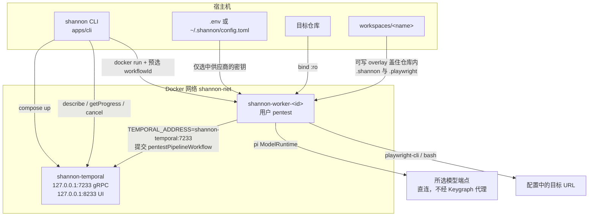
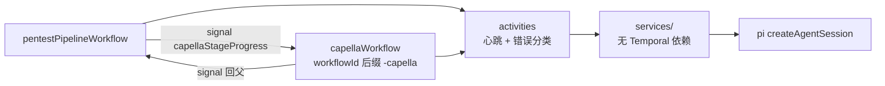
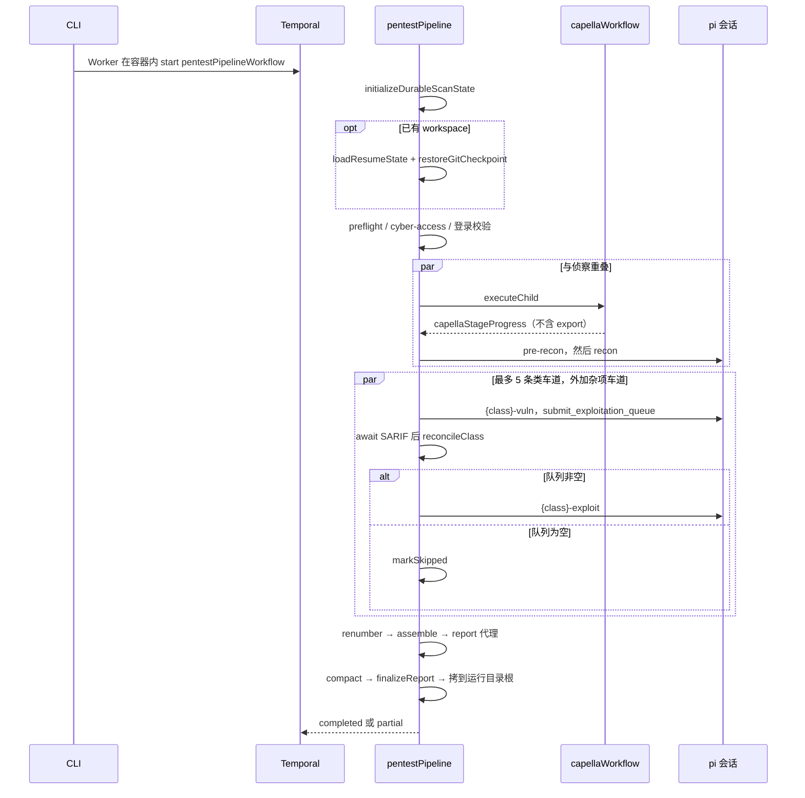
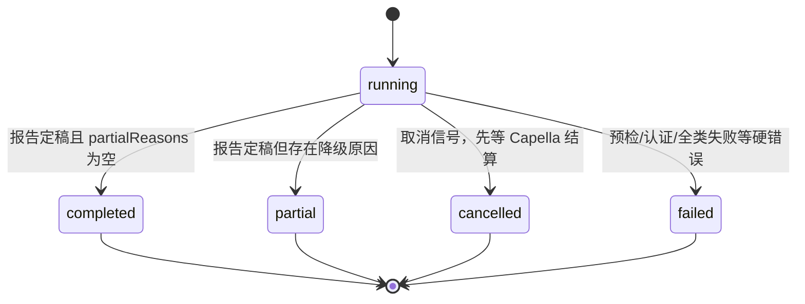
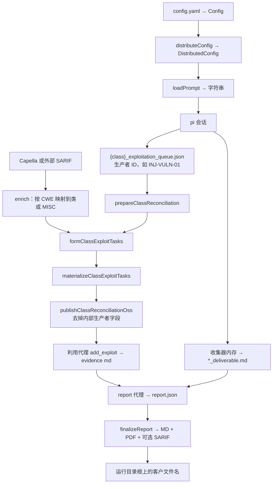

# Shannon 代码架构与实现

本文是对仓库 `Silver-cybersec/shannon` 在提交 `4cef63e`（`fix: validate workspace names and restrict target URLs to HTTP/HTTPS`）上的**只读静态分析**。阅读时没有安装依赖、没有构建或拉取镜像、没有启动进程，也没有对任何目标发请求。代码标识符、路径、环境变量和配置键保留原文。

仓库根目录没有 `SECURITY_AUDIT.md`。本文不引用、也不改动该文件。产品说明以 `README.md`、`CLAUDE.md` 和 `docs/` 为对照，实现以 `apps/` 源码为准；文档与代码不一致的地方记在第 10 节。

---

## 1. 一句话定位与适用场景

Shannon 是一个在操作者自己的机器（或 CI）上运行的**白盒自治渗透测试流水线**：它把目标源码只读挂进一次性 Worker 容器，用固定阶段的 Temporal 工作流驱动多个专用模型代理，对操作者指定的运行中 Web/API 做侦察、分类型分析和（默认开启的）实证利用，最后只把通过契约校验的结果渲染成 PDF、Markdown，以及在利用模式下的 SARIF。

它适合这些场景：

- 你同时拥有**源码**和**可攻击的非生产实例**，希望把“读代码找假设”和“对运行中的应用取证”串成一次可恢复的扫描。
- 你自带模型密钥（BYOK），流量直接打到所选供应商或网关，扫描状态留在本机 `workspaces/` 或 `~/.shannon/`。
- 你接受固定的五类分析面：`injection`、`xss`、`auth`、`authz`、`ssrf`。配置不能关掉其中一类，也不能再加一类公开分析代理。
- 你需要可恢复的长任务：代理可以跑很久，进程挂了之后用同一个 `-w` 工作区从已提交的交付物继续，而不是重放整段对话。

它不覆盖、也不在本仓库里实现的能力：无源码的黑盒测试、SCA/密钥扫描、漏洞生命周期和工单、修复 PR。`README.md` 把这些放在 Keygraph Pro / Enterprise。本仓库也没有把一次扫描做成“一个模型一直想到做完”的开放式助手。

授权边界写在 `docs/safety.md`：只对你拥有或已获书面授权的系统使用，且不要打生产。本文只解释实现，不提供针对任何真实目标的操作步骤。

---

## 2. 核心理念与设计取舍

Shannon 的控制面是**编译进仓库的阶段图**，模型只在阶段内部做工具循环。一次扫描的“下一步该谁跑”由 `pentestPipeline` 决定；模型决定的是“这一阶段里读哪份文件、调哪个工具、提交哪份结构化结果”。

### 2.1 外层是流水线，内层才是工具循环

常见的 ReAct 代理是一个循环：思考、调用工具、观察，直到模型自己停。Shannon 的每个业务代理内部确实是这种循环——`runPiPrompt` 创建一次 pi 的 `createAgentSession`，会话在内存里累积回合，`thinkingLevel` 固定为 `'high'`。但这个循环的寿命被阶段卡住：

- 漏洞分析代理必须调用 `submit_exploitation_queue` 一次，工具校验 ID 命名空间后结束回合，队列 JSON 由执行器落盘。
- 其它阶段用 TypeBox `defineTool` 收集器把章节写进内存，成功后由渲染器写成 Markdown。
- 会话管理器是 `SessionManager.inMemory()`。活动结束，对话就没了。下一阶段读的是文件，不是上一轮的消息历史。

所以 Shannon 的可恢复性不靠对话记忆，靠 Temporal 历史、`.shannon/session.json` 里的 `durableScanState`，以及交付物目录里的私有 git。

### 2.2 计划在源码里，不在规划模型里

Planner-Executor 通常让一个规划模型发出可变的任务图，再交给执行器。Shannon 的全局计划是 `apps/worker/src/temporal/workflows.ts` 里的函数顺序：预检、认证、可选的 Capella 子工作流、`pre-recon`、`recon`、五条漏洞车道、可选的 `miscellaneous` 车道、报告状态机。`AGENTS` 上的 `prerequisites` 注释写明它只是依赖说明，真正的顺序由工作流强制。

局部仍有窄的模型规划，但它们不改全局图：

- Capella 的 `plan` 阶段在静态分析子工作流内部决定要开哪些调查。调查数为 0 时直接导出空 SARIF。
- 和解（reconciliation）里的 task formation 把一类观察分组为利用任务。分组模型失败时，代码可以退回 singleton fallback，而不是让规划器重画整条流水线。

并发也是常量：`MAX_CONCURRENT_PIPELINES = 5`，五类一起跑；第六条 `miscellaneous` 车道与它们并行，但只在 Capella（或外部传入的 SARIF）结算出报告之后才有内容。Worker 的 `maxConcurrentActivityTaskExecutions` 是 25，用来容纳心跳中的活动与子工作流活动，不是动态扩出来的代理数量。

### 2.3 多代理，但代理之间不对话

这是多代理系统：`ALL_AGENTS` 有 14 个名字，外加不在该列表里的 `validate-authentication`。它们不互相发消息。交接物是：

| 交接 | 生产者 | 消费者 |
| --- | --- | --- |
| `pre_recon_deliverable.md` / `recon_deliverable.md` | 对应代理的收集器 + 渲染器 | 后续提示词让模型自己去读交付物目录 |
| `{class}_exploitation_queue.json` | 漏洞代理的 `submit_exploitation_queue` | 和解流水线改写后交给利用代理 |
| Capella SARIF | 子工作流 `export` | 各类 `enrichClassSastObservations`，以及 `miscellaneous` 车道 |
| `report.json` | 报告代理的 `add_finding` | `finalizeReport` 渲染 MD / PDF / SARIF |

`task` 工具会再开子会话，那是**同一个代理内部**的分工：子会话只有 `read`、`grep`、`find`、`ls`、`write`、`bash`，不能再嵌套 `task`，也不能调用收集器或提交工具。结构化结果始终属于父会话。

### 2.4 默认契约是“实证之后才进入渗透报告”

`distributeConfig` 在未写 `exploit` 时得到 `exploit === true`。为真时，一类队列里没有可执行项，对应的 `*-exploit` 代理被 `markSkipped`，不会为了凑报告去编利用。报告阶段还会对各类发现重编号、压缩，并默认写出 SARIF。

`exploit: "false"` 是另一条正式路径，不是把利用阶段跑完再丢掉：`expected_agents` 不含利用代理，`runVulnExploitPipeline` 在分析与和解之后停止，报告组装前由 `renderFindingsFromQueues` 把队列确定性渲染成 `*_findings.md`。`docs/safety.md` 和 `README.md` 的 “No exploit, no report” 描述的是默认渗透模式；分析模式仍会出报告，并带分析模式声明。见第 10 节。

### 2.5 其它稳定取舍

- **一个模型跑完全部阶段。** `SHANNON_AI_MODEL=<provider>:<model-id>`，默认 `anthropic:claude-sonnet-4-6`。`model-host.ts` 里的角色名最终都解析到同一次 `resolveModelSelection()`。
- **失败按车道降级，按阶段升级。** 单类错误变成 `partial` 原因并继续报告；五类全失败，或有无法归因的 rejection，抛 `PipelineFailedError`，整次扫描 `failed`。预检、网络侧的 cyber-access 校验、登录失败是不可重试错误。
- **薄 CLI、厚 Worker、一次扫描一个队列。** CLI 拉起 Docker 与 Temporal，用 `@temporalio/client` 查询和停止；业务在 Worker 里。`taskQueue` 每次启动新生成，避免活动落到挂错仓库的容器上。
- **秘密不进模型配置文件。** `RuntimeCredentialStore` 从环境变量供钥。`--models-config` 只读挂到 `/app/models.json`，文件里的 `apiKey` 不会压过环境变量。
- **目标仓库只读，扫描自己的文件可写。** 见第 5.3 节。这是挂载策略，不是提示词里的一句约定。

和三种常见形态对照：

| | Shannon 实际做成的样子 | 常见形态里容易假设的样子 |
| --- | --- | --- |
| ReAct | 阶段内是工具循环；阶段之间由工作流裁剪上下文并要求结构化提交 | 一个循环从侦察一路做到报告，停不停由模型决定 |
| Planner-Executor | 全局计划是 TypeScript；Capella `plan` 与 task formation 只规划自己的工件 | 规划模型可以增删代理、改阶段、改并发 |
| Multi-agent | 固定名单、文件交接、五路并行加一条有条件的杂项车道 | 代理互相聊天，或由主管模型动态招人 |

---

## 3. 整体架构图

### 3.1 组件与进程

宿主机上长期存在的只有 Temporal 开发服务器。每次 `start` 再拉起一个带 `--rm`（除非 `--keep-container`）的 Worker。CLI 自己不跑流水线。



Worker 进程里还有两层编排，都在同一个任务队列上（`executeChild` 没有改队列）：



### 3.2 一次典型扫描的时序与终态

下图是 `exploit` 为真、配置了认证、并打开 `agentic_sast.enabled: "true"` 的路径。没配认证时，认证活动返回 `null` 并继续。没开 SAST、也没传入外部 SARIF 时，Capella 状态是 `disabled`，`miscellaneous` 车道不跑。



终态机（工作流内存里的 `PipelineState.status`）：



`failed` 在写完审计日志之后还会 `throw ApplicationFailure.nonRetryable(..., 'PipelineExecutionError')`，因此 Temporal 里这次执行是失败，而不只是返回了一个 `status: 'failed'` 的值。`cancelled` 则正常返回状态。

报告还有自己的小状态机，存在 `durableScanState.report.stage`：`pending` → `draft` → `finalized`。崩溃后续跑从最后一次持久化的阶段接着做。`draft` 或 `finalized` 之后，工作流不再重跑渗透阶段，避免新的降级原因和已经提交的 `report.json` 对不上。

---

## 4. 目录与模块地图

```
shannon                         本地入口：设置 SHANNON_LOCAL=1 再加载 CLI
Dockerfile / entrypoint.sh      两阶段镜像；运行时降到 pentest 用户
docker-compose.yml              只含 Temporal
apps/cli                        发布为 @keygraph/shannon
  src/index.ts                  命令分发
  src/commands/start.ts         启动、恢复判定、等 session 注册
  src/docker.ts                 compose、镜像、docker run
  src/temporal-client.ts        只读查询 + 有界的 cancel/terminate
  src/scan/                     status 树：pipeline / derive / render
  src/env.ts + config/          .env 或 TOML，以及转发给容器的环境变量
  src/model-spec.ts             与 Worker 手工保持一致的模型解析表
  infra/compose.yml             npx 模式使用的 Temporal compose
apps/worker                     私有包，镜像里实际执行的代码
  src/temporal/workflows.ts     pentestPipeline
  src/temporal/activities.ts    活动外壳
  src/temporal/worker.ts        连 Temporal、注册活动、提交工作流
  src/session-manager.ts        AGENTS 注册表
  src/services/                 业务逻辑
  src/ai/pi/                    pi 会话、权限、子任务、重试
  src/ai/models.ts              模型与凭证
  src/ai/sast/capella/          静态分析子工作流
  src/ai/reconciliation/        观察 → 任务 → 发布队列
  src/collectors/               各阶段的自定义工具
  src/audit/                    session.json、日志、指标
  prompts/                      正式提示词；pipeline-testing/ 为短提示词
  configs/config-schema.json    闭合的 YAML schema
  templates/typst/report.typ    PDF 模板
```

| 模块 | 职责 | 关键符号 |
| --- | --- | --- |
| CLI 模式 | `SHANNON_LOCAL=1` 为本地，否则 npx | `getMode` |
| 启动 | 工作区分类、挂载、注册轮询 | `classifyWorkspaceLaunch`、`spawnWorker`、`createWorkflowId` |
| 工作流 | 阶段、并行、终态 | `pentestPipeline`、`runVulnExploitPipeline`、`finalizeReportPipeline` |
| 代理生命周期 | 提示词、git、pi、校验、提交 | `AgentExecutionService.execute` |
| 提示词 | `@include`、占位符、按 exploit 裁剪 | `loadPrompt`、`processIncludes` |
| 模型 | 规格、目录刷新、内存凭证 | `parseModelSpec`、`createModelRuntime` |
| 工具 | 内置工具名单、子会话、提交工具 | `BUILTIN_TOOLS`、`CHILD_TOOLS`、`createQueueSubmitTool` |
| 沙箱 | 挂载、`code_path` 拒绝、Capella 路径约束 | `spawnWorker`、`syncPermissionSystemConfig`、`RepositoryConfinement` |
| 状态 | 可查询进度与可恢复快照 | `PipelineState`、`DurableScanState` |
| 报告 | 结构化发现到三种客户文件 | `finalizeReport`、`copyReportToRunRoot` |

`apps/cli/src/exp-php2shell/` 是一条独立的 CLI 探针（`--exp-php2shell`），`start` 在进入 Docker 之前就返回。它不参与上面的流水线。

---

## 5. 核心实现

### 5.1 入口与配置

本地入口只有几行：未带开发用的 `--npx` 时设置 `SHANNON_LOCAL=1`，然后加载已构建的 CLI。

```1:10:shannon
#!/usr/bin/env node
const npxFlagIndex = process.env.SHANNON_DEV === '1' ? process.argv.indexOf('--npx') : -1;

if (npxFlagIndex === -1) {
  process.env.SHANNON_LOCAL = '1';
} else {
  process.argv.splice(npxFlagIndex, 1);
}

import('./apps/cli/dist/index.mjs');
```

`getMode()` 只看这个变量。两种模式的差别都从这里长出来：状态目录（`./workspaces` 或 `~/.shannon/workspaces`）、凭证（`./.env` 或 `~/.shannon/config.toml`）、compose 文件、镜像（本地 `shannon-worker` 或 `keygraph/shannon:<version>`）、提示词是挂载进去还是打进镜像。`setup` 只在 npx 存在，`build` 只在本地存在。

`apps/cli/src/index.ts` 的 `switch (command)` 分发 `start`、`stop`、`reset`、`logs`、`status`、`scans`、`setup`、`build`、`version`。`start` 的参数在 `parseStartArgs`：`-u/--url`、`-r/--repo`、`-c/--config`、`--models-config`、`-o/--output`、`-w/--workspace`，以及 `--pipeline-testing`、`--keep-container`、`-f/--follow`、`--validate-auth`、`--validate-model`、`--exp-php2shell`。

`start()` 在拉起容器之前就选定身份：`taskQueue`、容器名、`createWorkflowId`。全新工作区的 id 往往就是工作区名；恢复时是 `${workspace}_resume_${timestamp}`。这个 id 写进容器标签和 `.shannon/pending-workflows/`，因为此时 `session.json` 还不存在，`stop` 仍要能对上这次执行。Worker 镜像还必须带标签 `shannon.worker-protocol=workflow-id-v1`，否则 CLI 拒绝启动，避免旧镜像忽略预选 id。

Worker 入口是镜像的 `CMD`：`node apps/worker/dist/temporal/worker.js`。`startScan` 先读编排配置和恢复状态，再 `Worker.create`，活动注册表来自 `createProductionActivityRegistry`，然后 `client.workflow.start('pentestPipelineWorkflow', { taskQueue, workflowId, args })`。注释写明：队列每次新生成，别的扫描的活动不会在这个挂载上执行。`maxConcurrentActivityTaskExecutions` 为 25。

YAML 配置由 `config-schema.json` 闭合：`additionalProperties: false`。顶层键是 `authentication`、`rules`、`agentic_sast`、`exploit`、`report`、`description`、`rules_of_engagement`，以及仍留在 schema 里、标成 deprecated 的 `login`。`exploit`、`agentic_sast.enabled`、`report.sarif` 在 schema 里是字符串 `"true"` / `"false"`，`distributeConfig` 再收成布尔值。未写 `exploit` 时结果为 `true`。

```676:704:apps/worker/src/config-parser.ts
export const distributeConfig = (config: Config | null): DistributedConfig => {
  // ...
  const exploit = config?.exploit !== undefined ? config.exploit === 'true' : true;
```

`rules.avoid` / `rules.focus` 的 `type` 可以是 `url_path`、`subdomain`、`domain`、`method`、`header`、`parameter`、`code_path`。解析器校验形状、重复和 focus/avoid 冲突。运行时真正拦截工具的只有 `code_path`。其余类型被渲染进提示词。

凭证转发在 `buildEnvFlags`：始终写入 `TEMPORAL_ADDRESS=shannon-temporal:7233`，再附上 `SHANNON_AI_MODEL`、`SHANNON_AI_BASE_URL`、`SHANNON_AI_API_KEY` 以及**当前供应商**的密钥变量。没被选中的供应商密钥留在 CLI 进程。`SHANNON_USE_PI_AUTH` 本身不进容器；CLI 把宿主机的 `~/.pi/agent/auth.json` 挂到 `/tmp/.pi/agent/auth.json`，Worker 用 `piAuthPresent()` 发现它。

### 5.2 Agent 编排与提示词

注册表是 `AGENTS`。每个条目有 `promptTemplate` 和 `deliverableFilename`。五类分析、五类利用、`miscellaneous-exploit`、`pre-recon`、`recon`、`report` 都在这里。`miscellaneous-exploit` 没有对应的分析代理：它只接收别的阶段已经形成的发现。`report.prerequisites` 列出五个利用代理，不含杂项；这只是文档，工作流不读这个数组做门禁。

```13:20:apps/worker/src/session-manager.ts
// Single source of truth for every agent the pipeline can run. Each entry:
//   - prerequisites: the agents this one conceptually depends on. This is documentation
//     of the intended dependency graph, not an executed check. Actual phase ordering and
//     concurrency are enforced by the explicit phase structure in the Temporal workflow.
```

工作流侧的重试按活动种类拆开。业务代理：

```92:121:apps/worker/src/temporal/workflows.ts
const PRODUCTION_RETRY = {
  initialInterval: '5 minutes',
  maximumInterval: '30 minutes',
  backoffCoefficient: 2,
  maximumAttempts: 50,
  nonRetryableErrorTypes: [
    'AuthenticationError',
    'ConfigurationError',
    'InvalidTargetError',
    'AuthLoginFailedError',
    'PermanentError',
    'OpenAiCyberAccessError',
    'AnthropicCyberAccessError',
  ],
};
const acts = proxyActivities<typeof activities>({
  startToCloseTimeout: '2 hours',
  heartbeatTimeout: '60 minutes',
  retry: PRODUCTION_RETRY,
  cancellationType: ActivityCancellationType.TRY_CANCEL,
});
```

预检和认证用更短的 `SHORT_RETRY`。报告、和解、杂项种子这些会改 git 的活动使用 `WAIT_CANCELLATION_COMPLETED`，让一次写入在取消时收尾，而不是把提交截断。代理活动用 `TRY_CANCEL`，因为对话可以丢掉。活动实现里大约每 2 秒心跳一次。

`pentestPipeline` 的主路径：

1. 校验绝对 `repoPath`、SAST 与外部 SARIF 互斥、客户输出只能是 `/app/output`。
2. `initializeDurableScanState` 写入 `expectedAgents` 和 `participatingClasses`。`exploit === false` 时期望列表不含利用代理。
3. 恢复时 `loadResumeState`：URL 与 `exploit` 必须和本次一致；代理算完成，除了 `status === 'success'`，还要交付物文件还在。`report` 只在 `stage === 'finalized'` 时算完成。然后 `git reset --hard` 到交付物仓库里选出的提交。
4. `runPreflightValidation`、可选的 `runCyberAccessVerification`。`--validate-model` 到此结束。
5. `syncPlaywrightStealthConfig`、`runAuthenticationValidation`。`--validate-auth` 到此结束；没有 `authentication` 块则是配置错误。
6. `initDeliverableGit`、`syncCodePathDenyRules`。
7. 若期望代理没全部完成，且报告还不是 `draft`/`finalized`：启动 Capella 结算承诺，串行跑 pre-recon 与 recon，再并行跑五类。
8. `finalizeReportPipeline`，然后用 `partialReasons.length` 决定 `completed` 还是 `partial`。

一类车道的分支：

```746:788:apps/worker/src/temporal/workflows.ts
async function runVulnExploitPipeline(...) {
  // vuln 代理（可因 resume 跳过）
  // await 同一个 Capella 承诺
  // reconcileClass → checkExploitationQueue
  if (exploit && shouldSkip(exploitAgentName)) {
    markCompleted(exploitAgentName);
  } else if (exploit && decision.shouldExploit) {
    exploitMetrics = await runExploitAgent();
    // ...
  } else if (exploit) {
    markSkipped(exploitAgentName);
  }
}
```

类内错误被接住，记成 `class_pipeline_failed` 或 `class_reconciliation_failed`。`aggregatePipelineResults` 只在“五类都失败”或“出现无法归因的 rejection”时让整段失败。

杂项车道：

```1129:1133:apps/worker/src/temporal/workflows.ts
async function runMiscellaneousExploitLane(capella: Promise<CapellaSettlement>): Promise<void> {
  const settled = await capella;
  if (settled.outcome === 'cancelled') throw settled.error;
  if (settled.sarif !== undefined) await runMiscellaneousPipeline(settled.sarif);
}
```

没有 SARIF 就不会有 `miscellaneous`。有 SARIF 时，它先写入一份规范的空 `miscellaneous_exploitation_queue.json`，再按 CWE 映射把类别为 `MISC` 的静态发现和解进这条队列。五类漏洞代理的队列不会被合并进杂项；它们的 ID 命名空间在提交工具里就被限制在本类。

Capella 子工作流的阶段是固定的十步：`architecture` → `threat-model` → `plan` →（无调查则 `export`）→ `research` →（无发现则 `export`）→ `dedupe` → `review` → 若仍有存活发现则 `critic` → `confirm` → `calibrate` → `export`。每步通过信号 `capellaStageProgress` 告诉父工作流。`export` 不发信号，因为它不跑模型。信号失败被吞掉，避免父工作流已经关闭时拖垮静态分析。

`AgentExecutionService.execute` 的步骤与源码注释一致：

1. `ConfigLoaderService.loadOptional`
2. `loadPrompt`
3. `createGitCheckpoint`（重试前先回滚该代理的路径）
4. `auditSession.startAgent`
5. `runPiPrompt`；漏洞代理附带 `createQueueSubmitTool`
6. 失败则回滚并记一次失败尝试
7. 在 `withGitRepoLock` 里写队列 JSON、`validateAgentOutput`、`writeDeliverable`、`commitGitSuccess`

漏洞代理的校验器只检查队列文件是否存在，因为 Markdown 要等渲染器在校验之后才写入。利用代理的校验器直接返回真，证据文件同样由渲染钩子写。报告代理则检查 `comprehensive_security_assessment_report.md`。

提示词组装在 `loadPrompt`：

- `--pipeline-testing` 时改读 `prompts/pipeline-testing/` 下的同名文件。
- `PLAYWRIGHT_SESSION_MAPPING` 按**模板名**分配 `agent1`…`agent6`，让并行代理的浏览器会话分开。`exploit-miscellaneous` 用 `agent6`。
- `vuln-auth.txt` 与 `exploit-auth.txt` 不 `@include(shared/_shared-session.txt)`，登录由这两个代理自己做。其余漏洞/利用模板以及 `recon.txt` 会包含它。
- `processIncludes` 展开 `@include(...)`，路径必须留在提示词目录内。
- `interpolateVariables` 替换 `{{WEB_URL}}`、`{{REPO_PATH}}`、`{{LOGIN_INSTRUCTIONS}}` 等，并按 `exploit` 删掉对立的模式块。空的规则、认证、交战规则块会被整段去掉。

共享片段的角色：`_target.txt` 描述 URL 和可写目录；`_code-path-rules.txt` 告诉模型哪些路径会被工具层拒绝；`_rules.txt` 是 URL 类规则；`_rules-of-engagement.txt` 是自由文本；`login-instructions.txt` 按 form/SSO/API/basic 和 TOTP 渲染；`_vuln-scope.txt` 与 `_exploit-scope.txt` 约束测试范围。Capella 用另一套 Handlebars 模板，在 `prompts/sast/capella/`。

### 5.3 工具注册与沙箱边界

一次主代理会话的工具由三部分拼成。

内置（pi 自带，Shannon 只点名）：

```59:60:apps/worker/src/ai/pi/pi-executor.ts
const BUILTIN_TOOLS = ['read', 'bash', 'edit', 'write', 'grep', 'find', 'ls'];
```

每次都加的自定义工具：`task`（`createTaskTool`）、`todo_write`、`glob`。调用方再传入该阶段的收集器。漏洞代理再加 `submit_exploitation_queue`。

```44:47:apps/worker/src/ai/pi/task-tool.ts
const CHILD_TOOLS = ['read', 'grep', 'find', 'ls', 'write', 'bash'];
```

阶段收集器（都在 `apps/worker/src/collectors/`，经活动层传入）：

| 阶段 | 工具 |
| --- | --- |
| pre-recon | `set_executive_summary`、`set_application_intelligence`、`set_auth_deep_dive`、`set_codebase_indexing`、`set_critical_file_paths`、`set_xss_sinks`、`set_ssrf_sinks` |
| recon | `set_executive_summary`、`set_technology_stack`、`set_authentication`、`add_endpoints`、`set_input_vectors`、`set_network_map`、`set_role_architecture`、`set_authz_candidates`、`set_injection_sources` |
| vuln-* | `set_findings_summary`、`set_strategic_intelligence`、`set_safe_vectors`、`set_blind_spots` |
| exploit-* | `add_exploit` |
| report | `add_finding` |

收集器在会话期间只改内存。Markdown 在会话成功之后由 `*-renderer.ts` 写出。队列是例外：`submit_exploitation_queue` 把参数留在闭包里，`execute` 在锁内把 `structuredOutput` 写成 `{class}_exploitation_queue.json`。

Capella 不用这套内置工具。`createCapellaRepositoryTools` 只提供受 `RepositoryConfinement` 约束的 `read` / `find` / `grep`：真实路径不能逃出仓库根，拒绝 glob（含 `.shannon/**` 与 `.playwright/**`），并限制单次读取大小、枚举深度、条目数和超时。它的会话 `noExtensions: true`。task formation 同样只读：`read`、`grep`、`find`、`ls`、`glob`、`submit_result`，没有 `bash`。

经 `bash` 调用、而不是 pi 工具的程序：镜像里的 `playwright-cli`、`save-deliverable`、`generate-totp`、`set-report-meta`。`runPiPrompt` 把 `PLAYWRIGHT_MCP_OUTPUT_DIR` 指到 `.shannon/.playwright-cli`，把 `SHANNON_DELIVERABLES_SUBDIR` 指到本次交付物相对路径。`bash-timeout` 扩展在主会话和子会话上强制 bash 超时落在 1–600 秒。Capella 与 task formation 不加载这个扩展。

沙箱是几层叠起来的，强度不一样：

| 边界 | 谁来执行 | 实际效果 |
| --- | --- | --- |
| 目标仓库树 | `spawnWorker` 的 `:ro` 挂载 | 宿主仓库除 overlay 外不能被容器改写 |
| 扫描私有文件 | 工作区目录覆盖 `repo/.shannon/deliverables`、`scratchpad`、`.playwright-cli` 以及 `repo/.playwright` | 这些路径可写，而且写到工作区，不写进宿主仓库的对应目录 |
| `code_path` avoid | `syncCodePathDenyRules` → `@gotgenes/pi-permission-system` | 有规则时，匹配路径在 read/edit/write/grep/find/ls 和一部分 bash 文件命令上被拒绝，子 `task` 同样生效。没有 avoid 时扩展不加载 |
| URL / 方法 / 头 / 参数 / 域 | 只进入提示词 | 仓库里没有对应的 HTTP 拦截器 |
| 交战规则 | 只进入提示词 | 自由文本，无单独执行器 |
| 容器用户 | `entrypoint.sh` | 以 `pentest` 运行；Linux 上 CLI 传入宿主 uid/gid 并重建该用户，使绑定挂载的属主与调用者一致 |
| 系统调用 | `--security-opt seccomp=unconfined` | 为了 Chromium。注释写明这是整容器设置，不只是浏览器 |
| 目标 URL 预检 | `runPreflightChecks` | 配置的目标必须能解析，且不能落在 `169.254.0.0/16`。这不包裹代理后来用 bash 发出的其它连接 |
| Capella 读盘 | `RepositoryConfinement` | 只约束静态分析工具，不约束主代理的内置 `read` |

`_target.txt` 把仓库描述成只读、把两个 `.shannon` 子目录描述成可写。只读这一半由 Docker 挂载落实；可写目录就是 overlay。主代理仍然注册了 `write` 和 `edit`，因此容器里挂载之外的可写位置（例如 `/tmp`，以及上述 overlay）可以被工具写到。这是实现边界，不是提示词能单独保证的。

### 5.4 记忆与状态

Shannon 没有向量库，也没有跨扫描的对话记忆。记忆分四层：

1. **会话内。** `SessionManager.inMemory()`，并打开 pi 的 compaction，避免长对话撑破上下文。子 `task` 的 token 记回父会话的用量。活动一结束，这些消息就没了。
2. **阶段间。** 交付物目录里的 Markdown、队列 JSON、证据和 `report.json`。下一个代理若需要它们，是提示词让它去读文件。
3. **一次扫描的可恢复快照。** `AuditSession` 写 `.shannon/session.json`。里面有 `session`（id、URL、状态、`originalWorkflowId`、`resumeAttempts`）、`metrics`，以及 `durableScanState`。
4. **交付物 git。** `initDeliverableGit` 在交付物目录单独 `git init`，与目标仓库的 git 无关。每个代理成功时只提交自己的路径（`getAgentGitPaths`）。恢复时 `restoreGitCheckpoint` 硬重置到已完成代理里最新的提交，并用 `git clean` 清掉未完成代理的半成品，同时排除已完成路径。

`DurableScanState` 是恢复时的权威，而不是“会话里曾经成功过”这一句话：

```832:839:apps/worker/src/types/run-state.ts
export interface DurableScanState {
  readonly schema_version: typeof DURABLE_SCAN_STATE_SCHEMA_VERSION;
  readonly exploit: boolean;
  readonly participating_classes: readonly ReconciliationClass[];
  readonly expected_agents: readonly AgentName[];
  readonly miscellaneous_outcome?: MiscellaneousOutcome;
  readonly report?: ReportProgress;
}
```

`MiscellaneousOutcome` 为 `exploitation_disabled`、`not_actionable`、`expected` 或 `completed`。恢复时若已经是终态，杂项车道不再重新决定要不要利用。

工作流查询 `getProgress` 返回的是内存中的 `PipelineState` 加上 `workflowId` 和 `elapsedMs`。CLI 不能 import Worker，于是在 `apps/cli/src/scan/pipeline.ts` 手工复制了这组类型和“活动名 → 代理名”映射。`status` 与 `--json` 都走 `derive.ts` 的纯函数。树只显示仍在跑或已失败的模型工作；和解的耗时画在对应类的利用行上，而不是单独一行。

还有一个容易混淆的开关：`PipelineInput.checkpointsEnabled` 默认不传，`buildPipelineInput` 也不设置它。因此工作流里的 `saveCheckpoint` 活动在开源路径上不跑。那个活动只是调用 `CheckpointProvider.onAgentComplete`，默认实现是 `NoOpCheckpointProvider`。真正让恢复成为可能的，是第 3 点里的 `session.json` 和第 4 点里每个代理自己的 git 提交。

认证会话文件 `auth-state.json` 由登录预检写在审计目录。工作流结束时删掉，避免 cookie 留在磁盘上。后续代理通过 `_shared-session.txt` 尝试加载；加载失败再走完整登录。`vuln-auth` / `exploit-auth` 不走这个包含文件。

日志方面，`WorkflowLogger` 写合并的 `workflow.log`，`actor-projection.ts` 再投影到 `.shannon/agents/<slug>.log`。投影失败不影响主日志。CLI 的 `logs --agent` 读这些文件。

### 5.5 LLM 接口

规格解析只按**第一个**冒号切开，这样 Bedrock 的模型 id 可以继续含冒号：

```83:99:apps/worker/src/ai/models.ts
export const DEFAULT_MODEL_SPEC = 'anthropic:claude-sonnet-4-6';
export const PI_CATALOG_URL = 'https://pi.dev/models';

export function parseModelSpec(spec: string): ModelSpec {
  const trimmed = spec.trim();
```

策展供应商是 `anthropic`、`openai`、`xai`、`amazon-bedrock`，密钥变量分别是 `ANTHROPIC_API_KEY`（另有 `CLAUDE_CODE_OAUTH_TOKEN`）、`OPENAI_API_KEY`、`XAI_API_KEY`、`AWS_BEARER_TOKEN_BEDROCK`（区域用 `AWS_REGION`，不算密钥）。其它 pi 供应商走 `SHANNON_AI_API_KEY`。未知供应商不会在 `parseModelSpec` 被拒绝，而是到 `ModelRuntime` 解析时失败，错误信息指向 `https://pi.dev/models`。

`createModelRuntime` 使用 `allowModelNetwork: true`，启动时刷新模型目录，超时后回到静态目录。`--models-config` 存在时 `modelsPath` 为 `/app/models.json`，否则显式设为 `null`，避免 pi 默认再去读代理目录旁边的 `models.json`（那个目录和可写的 pi auth 挂载相邻）。自定义条目覆盖同 id 的内置模型；`RuntimeCredentialStore` 的优先级高于文件里的 `apiKey`。`SHANNON_AI_BASE_URL` 在解析之后盖住端点，但不免除“模型必须在注册表里”这一条。注释说明 pi 的内置 `openai` 供应商走 Responses API；只支持 Chat Completions 的网关需要换一个原生走该 API 的供应商 id，例如 `openrouter`。

重试被故意拆成两层：

```25:28:apps/worker/src/ai/pi/retry-settings.ts
export const PI_RETRY_SETTINGS = {
  enabled: false,
  provider: { maxRetries: 8, maxRetryDelayMs: 120_000 },
} as const;
```

`enabled: false` 关掉 pi 自己的代理级重试，让 Temporal 的活动重试成为唯一的“整段重跑”。`provider.maxRetries` 仍吸收传输层的 408/409/429/5xx，避免一次抖动就付一整段代理的费用。注释也记录了反面：供应商 SDK 的重试可能在 pi 把“额度用尽”标成终态之前先消耗响应。Shannon 选择保留传输层覆盖，并把单次延迟帽定在两分钟。

思考级别没有公开配置。主会话、子 `task`、Capella 和 task formation 都把 `thinkingLevel` 设为 `PI_THINKING_LEVEL`（`'high'`）。预检的 `createAgentSession` 不传 `thinkingLevel`。和解增强的 `completeSimple` 只传 `maxTokens` 和 `maxRetries: 0`，不传 `reasoning`。

CLI 的 `apps/cli/src/model-spec.ts` 手工复制了解析规则和供应商表。两边没有共享类型。只改一边时，TypeScript 不会报错，CLI 的转发和 Worker 的读取会在运行时分叉。

### 5.6 结果与产物

客户看得到的运行目录很干净。常量在 `apps/worker/src/paths.ts`：

- 根上的 `Security-Assessment-Report.pdf` 与 `Security-Assessment-Report.md`
- 利用模式且未关闭 SARIF 时，根上还有 `report.sarif`
- 其余都在 `.shannon/`：`session.json`、`workflow.log`、`agents/`、`deliverables/`、`scratchpad/`、浏览器目录、`launch.json`（仅 CLI 写）、`startup-error.json`（工作流还没提交就失败时）

交付物目录里的内部名字包括 `comprehensive_security_assessment_report.md`、同名 PDF、`report.json`、`report.sarif`、`report_finalization_manifest.json`，以及各阶段的 `*_deliverable.md`、`*_exploitation_queue.json`、`*_exploitation_evidence.md`。

报告状态机 `finalizeReportPipeline`：

1. `exploit` 为真时，对每个参与类 `renumberClassFindings`。失败记 `report_renumber_failed`，不中断。
2. `initializeReportProgress`，阶段 `pending`。
3. `assembleReportActivity`。分析模式先 `renderFindingsFromQueues`。然后 `runReportAgent`：报告模型调用 `add_finding`，写出 `report.json`，成功提交后阶段变为 `draft`。
4. `exploit` 为真时 `compactReportFindings`。再 `persistCanonicalReportProgress`。
5. `finalizeReportOutputs` → `finalizeReport`：从 canonical JSON 渲染 Markdown；利用模式调用 `renderSarif`；`renderReportPdf` 用 Typst 编译，失败只记 provenance，不让扫描失败。SARIF 渲染在自己的重试耗尽后，可以降级为没有 SARIF 的定稿，并记 `report_sarif_failed`。
6. `surfaceReportOutputs` 把客户文件拷到运行目录根，或拷到 `-o` 对应的 `/app/output`。拷贝失败是 non-fatal，canonical 文件仍算定稿。

`min_severity` 对两种模式都写进报告提示词。`min_confidence` 只在 `exploit === false` 时生效，利用模式会忽略并警告。过滤发生在提示词约束和代理行为，`finalizeReport` 不再按严重性删条目；它把这些设置放进输入指纹，用来让定稿清单幂等。

SARIF 只在利用模式、且 `report.sarif` 不是 `"false"` 时生成。渲染器故意不写入利用步骤；critical 与 high 在 SARIF level 上也不再区分。

`save-deliverable` 是给代理用的窄 CLI，只接受 `types/deliverables.ts` 里列出的分析阶段文件名。利用证据和报告不走它。

错误在服务层是 `Result<T, E>` 加上 `PentestError` / `ErrorCode`。活动层把它们分类成 Temporal 的 `ApplicationFailure`：配置、认证、永久错误不重试；输出校验在第 3 次尝试后变成不可重试。工作流展示给 CLI 的句子来自封闭的 `SAFE_WORKFLOW_FAILURE_MESSAGES`，而不是把供应商返回的原文直接打到终端。

---

## 6. 数据流与关键类型

一次默认扫描里，数据经过这些形态：



和解的公开活动名在 `RECONCILIATION_ACTIVITY_NAMES`：`seedEmptyProducerQueue`、`prepareClassReconciliation`、`enrichClassSastObservations`、`formClassExploitTasks`、`materializeClassExploitTasks`、`publishClassReconciliationOss`。中间工件留在交付物 git 里（观察、分组、固定任务），发布步把队列换成利用代理可读的任务 ID，并去掉 `FORBIDDEN_PUBLISHED_KEYS`。

关键类型（字段是阅读代码时的索引，不是全部可选细节）：

| 类型 | 位置 | 记住什么 |
| --- | --- | --- |
| `PipelineInput` | `temporal/shared.ts` | `webUrl`、`repoPath`、`resumeFromWorkspace`、`exploit`、`authOnly`、`validateModel`、`agenticSast`、`sastSarif`、`checkpointsEnabled` |
| `PipelineState` | 同上 | `status`、`currentPhase`、`currentAgent`、`completedAgents`、`skippedAgents`、`expectedAgents`、`failedPipelines`、`agentMetrics`、`operationalStages`、`agenticSast`、`partialReasons`、`reportProgress`、`summary` |
| `AgentName` | `types/agents.ts` | `ALL_AGENTS` 的 14 个字面量。不含 `validate-authentication` |
| `VulnClass` | `types/config.ts` | 固定五元：`injection`、`xss`、`auth`、`authz`、`ssrf` |
| `ReconciliationClass` | `types/reconciliation.ts` | 五类再加 `miscellaneous` |
| `DistributedConfig` | `types/config.ts` | 已经拆平的 avoid/focus、认证、`exploit: boolean`、报告选项 |
| `AgentEndResult` | `types/audit.ts` | 一次尝试的耗时、费用、token、`turns`、`success`、`checkpoint` |
| `AgentMetrics` | `types/metrics.ts` | 工作流状态里保存的成功指标；没有名为 `AgentResult` 的导出类型 |
| `ExploitationDecision` | `types/agents.ts` | `shouldExploit`、`vulnerabilityCount`；`shouldRetry` 现为恒假，校验失败改由抛错表达 |
| `ReportProgress` | `types/run-state.ts` | `pending` / `draft` / `finalized`，以及 git 提交与 SARIF、PDF 出处 |
| `DurableScanState` | 同上 | schema 1。恢复与“这次期望哪些代理”的来源 |
| `Result<T,E>` | `types/result.ts` | `{ ok: true, value }` 或 `{ ok: false, error }` |
| `ErrorCode` | `types/errors.ts` | 配置、代理、git、提示词、预检、模型、cyber-access |
| `SarifRef` | `ai/sast/types.ts` | `path` + `sha256`。类车道等待的是这个引用，不是 SARIF 正文 |
| `CapellaStage` | 同上 | 十个阶段名；进度行用 `CAPELLA_PROGRESS_STAGES`，去掉 `export` |

`PipelineState` 的注释自己说明了 CLI 镜像风险：

```181:188:apps/worker/src/temporal/shared.ts
/**
 * The workflow's whole queryable and terminal state. The CLI cannot import this package, so
 * `apps/cli/src/scan/pipeline.ts` mirrors this shape ...
 */
export interface PipelineState {
  status: 'running' | 'completed' | 'failed' | 'cancelled' | 'partial';
```

服务容器在 `getOrCreateContainer(workflowId)`。每个工作流一份。`AuditSession` 故意不放进容器：并行代理各有一份，避免共享 `currentAgentName`。`FindingsProvider`、`CheckpointProvider`、`ReportOutputProvider` 默认是空操作。`setContainerFactory` 存在，但开源启动路径没有调用它。

---

## 7. 扩展点

能扩展的地方，和被故意焊死的地方，要分开看。

可以改、而且设计上留了口子：

- **提示词。** 本地模式把 `apps/worker/prompts` 以只读方式挂进容器，改完即生效，不用重建镜像。`@include` 的共享片段是稳定的插入点。`--pipeline-testing` 用短模板跑通编排。
- **模型。** 任意 pi 注册表里的 `<provider>:<model-id>`，或一份 `--models-config`。新供应商若只是一把 API key，走 `SHANNON_AI_API_KEY` 和 setup 向导里的 “Other provider”。策展供应商要同时改 Worker 的 `PROVIDER_API_KEY_ENV` 和 CLI 的 `model-spec.ts`。
- **新的收集器工具。** 在 `collectors/` 用 `defineTool` 定义，再在对应活动里传给 `runAgentActivity`。提交工具的模式在 `queue-schemas.ts`。
- **Capella 阶段提示词。** `prompts/sast/capella/*.prompt.hbs` 与同目录的阶段实现。加阶段还要改 `CAPELLA_STAGES`、活动策略、子工作流顺序和父工作流能接受的信号集合。
- **报告外观。** `templates/typst/report.typ` 与 `report-renderer.ts` / `sarif-renderer.ts`。严重性门槛已经是配置，不是代码常量。
- **容器外的钩子。** `setContainerFactory` 可以换成非空的 findings/checkpoint/report provider。开源进程没有第二份实现。

被闭合、改一处不够的：

- **五类分析。** `ALL_VULN_CLASSES`、schema、`buildPipelineConfigs`、`assertFixedAnalysisScope` 互相咬合。没有“只跑 XSS”的配置。杂项不是第六个公开分析类，它没有漏洞分析代理，而且没有 SARIF 时整条车道不存在。
- **YAML 形状。** 未知键会被 schema 拒绝。旧的 `path` 规则类型会得到“已改名为 `url_path`”的明确错误。
- **代理名单。** 新代理要同时动 `ALL_AGENTS`、`AGENTS`、`AGENT_VALIDATORS`、`AGENT_PHASE_MAP`、提示词、活动包装、工作流阶段，往往还要动 CLI 的 `pipeline.ts` 镜像。漏一处时，恢复或状态树会静默漏掉这个名字。
- **工作流 id 协议。** CLI 与镜像标签 `workflow-id-v1` 是一对。旧镜像不能和新 CLI 混用。

---

## 8. 复现与部署要点（只读）

下面只描述仓库里已经写明的部署形状，方便对照源码。按本文的约束，这些命令没有在本次分析里执行。

进程模型：

- Temporal：`temporalio/temporal:1.7.0`，命令 `server start-dev`，数据库文件在卷 `temporal-data`。端口绑定 `127.0.0.1:7233` 与 `127.0.0.1:8233`。网络名 `shannon-net`。npx 用 `apps/cli/infra/compose.yml`，本地用根目录 `docker-compose.yml`，两者结构相同。
- Worker：每次扫描一个容器，名字 `shannon-worker-<8 hex>`，同一网络，默认 `--rm`。`--shm-size 2gb`。Linux 上追加 `host.docker.internal:host-gateway`（探测到 Podman 时不加）。宿主机 `/etc/hosts` 里的用户条目会被转成 `--add-host`，回环改写成 `host-gateway`；`SHANNON_FORWARD_HOSTS=false` 关掉这一步。
- 镜像构建见 `Dockerfile`：Wolfi 两阶段，pnpm 10.33.0，只构建 `@shannon/worker`。运行时含 Node 22、git、Python 3、Chromium、Typst 0.14.2、`@playwright/cli@0.1.1`。入口 `entrypoint.sh` 再 `su` 到 `pentest`。

CLI 与 Worker 的节点版本要求并不相同：`apps/cli/package.json` 的 engines 面向发布的 CLI；Worker 镜像安装的是 `nodejs-22`。README 把 Node.js 22+ 写成 npx 路径的前提。

和扫描有关的环境变量：

| 变量 | 作用 |
| --- | --- |
| `SHANNON_LOCAL` | 由 `./shannon` 设为 `1`。决定本地模式 |
| `SHANNON_AI_MODEL` | `<provider>:<model-id>`，默认 `anthropic:claude-sonnet-4-6` |
| `SHANNON_AI_BASE_URL` | 覆盖端点，不改变供应商方言 |
| `SHANNON_AI_API_KEY` | 非策展供应商，也可作策展供应商的后备；Bedrock 不用它 |
| `ANTHROPIC_API_KEY` / `OPENAI_API_KEY` / `XAI_API_KEY` / `AWS_BEARER_TOKEN_BEDROCK` + `AWS_REGION` | 策展凭证。只有被选中的那一组进入容器 |
| `SHANNON_USE_PI_AUTH` | CLI 侧开关。为真且 `~/.pi/agent/auth.json` 存在时挂载该文件 |
| `SHANNON_TEMPORAL_RETENTION` | CLI 在宿主机上把 namespace 保留期收敛成整小时，默认 `168h` |
| `SHANNON_FORWARD_HOSTS` | 是否转发 `/etc/hosts` |
| `SHANNON_HOST_UID` / `SHANNON_HOST_GID` | 仅 Linux，由 CLI 注入，供入口脚本改 uid |
| `TEMPORAL_ADDRESS` | 容器内被设为 `shannon-temporal:7233`。CLI 自己的客户端固定连 `127.0.0.1:7233` |

工作区：`-w` 给出名字；否则由 URL 主机名和时间戳生成。恢复要求目录里已经有 `session.json` **和** `.shannon/launch.json`，URL 一致，`-o` 与记录一致，`durableScanState` 能通过与 Worker 孪生的校验。没有 `launch.json` 的旧目录不能恢复。`--validate-auth` 与 `--validate-model` 必须是新工作区。

`stop` 先请求取消，等一小段时间，必要时再终止，并核对容器与 Temporal 可见性；核对不了就以未确认失败退出，而不是打印已停止。`reset` 会停掉匹配的 Worker 容器并 `compose down -v`，从而删掉 Temporal 的本地库。

原生 Windows 在 CLI 入口被拒绝，提示改用 WSL2。`blockSudo` 避免绑定挂载出来的文件属主变成 root。

---

## 9. 阅读路线

建议按“一次 `start` 会碰到谁”来读，而不是按目录字母序。

1. `README.md` 的 Architecture 小节，建立“源码假设 + 静态分析 + 和解 + 利用 + 报告”的产品语言。读的时候记住：图里的 Discard 是默认利用模式的叙述。
2. `shannon`、`apps/cli/src/mode.ts`、`apps/cli/src/index.ts`，确认命令和两种模式。
3. `apps/cli/src/commands/start.ts` 的 `classifyWorkspaceLaunch` 与 `createWorkflowId`，再读 `apps/cli/src/docker.ts` 的 `spawnWorker`。挂载清单是后面所有“文件写到哪”的前提。
4. `apps/worker/src/temporal/worker.ts` 的 `startScan`，然后 `workflows.ts` 的 `pentestPipeline`。文件长，但第 5.2 节的编号能当目录。先看 `PRODUCTION_RETRY`、`runVulnExploitPipeline`、`runMiscellaneousExploitLane`、`finalizeReportPipeline` 和文末的 `catch`。
5. `session-manager.ts` 的 `AGENTS` 与 `PLAYWRIGHT_SESSION_MAPPING`，对照 `prompts/` 里同名模板的前几十行，看它 `@include` 了什么。不必先通读利用模板的操作细节。
6. `services/agent-execution.ts` 的 `execute`，接着 `ai/pi/pi-executor.ts` 的 `runPiPrompt` 和 `ai/models.ts`。这样工具名单、重试和凭证是连在一起的。
7. `ai/queue-schemas.ts` 的 `createQueueSubmitTool`，再看 `ai/reconciliation/` 的 `prepare` → `enrich` → `form` → `materialize` → `publish`。这是“分析文”变成“利用任务”的地方。
8. `ai/sast/capella/temporal/workflow.ts` 从 `capellaWorkflow` 读阶段顺序，再看 `tools/confinement.ts` 的限制常量。它和主代理的工具策略不同。
9. `types/run-state.ts` 的 `ReportProgress` 与 `DurableScanState`，然后 `services/report-finalization.ts` 的 `finalizeReport`。最后用 `paths.ts` 把内部文件名和客户文件名对上。
10. 需要看 CLI 进度时再读 `apps/cli/src/scan/pipeline.ts` 与 `derive.ts`，并时刻对照 Worker 的 `PipelineState`。

只想确认某条不变量时，可以直接搜这些符号：`ALL_VULN_CLASSES`、`MAX_CONCURRENT_PIPELINES`、`PI_RETRY_SETTINGS`、`BUILTIN_TOOLS`、`CHILD_TOOLS`、`distributeConfig`、`reportIsAuthored`、`CAPELLA_PROGRESS_STAGES`。

---

## 10. 未确认与缺口

本次是静态阅读。下面这些点要么代码与文档不一致，要么要跑起来才能证实，不能写成已经观察到的行为。

**仓库里没有的材料**

- 没有 `SECURITY_AUDIT.md`。
- `apps/` 下没有检索到 `TODO` / `FIXME`。测试很少：CLI 侧能看到 `exp-php2shell` 的单元测试；Capella 的 `*.test.hbs` 是提示词夹具，不是本仓库里的测试运行器。Worker 流水线没有随代码一起放在树里的自动化测试入口。因此“活动重试 50 次是否真的如此调度”只来自 `proxyActivities` 的参数，没有测试日志。

**文档与代码不一致**

- `apps/worker/configs/example-config.yaml` 写着 “Skip the exploitation phase (optional, default: `"true"`)”，下一行被注释掉的却是 `exploit: "false"`。`distributeConfig` 的默认是**跑利用**（`exploit === true`）。这行注释容易读反。
- `paths.ts` 的 `resolveSessionJsonPath` 注释说旧布局的 `session.json` 仍可恢复。CLI 的 `classifyWorkspaceLaunch` 在缺少 `.shannon/launch.json` 时直接拒绝，并说明这是更早版本创建的工作区。列表命令仍能双读旧文件，恢复不能。
- `README.md` 架构图把“没有展示出的利用”画成 Discard。`exploit: "false"` 仍会从队列生成发现并出报告。`docs/safety.md` 与 `docs/coverage-roadmap.md` 强调的也是实证模型，没有把分析模式写成同等的一等产物。分析模式的声明在报告渲染器里（`ANALYSIS_ONLY_DISCLAIMER`）。
- `AGENTS.report.prerequisites` 不含 `miscellaneous-exploit`。工作流在报告前会等待杂项车道的承诺，名单本身不是门禁。

**实现上的非目标，容易被读成已经强制**

- `rules` 里除 `code_path` 以外的类型只出现在提示词和 schema 校验中。没有统一的出站请求过滤器。
- 预检对**配置的目标 URL** 拒绝链路本地元数据网段。主代理的 `bash` 之后还能连哪里，不受这层检查约束。
- `seccomp=unconfined` 作用在整个 Worker 容器。
- Capella 的 `RepositoryConfinement` 不包裹主代理的内置 `read`/`grep`/`bash`。
- 报告的 `min_severity` / `min_confidence` 不在 `finalizeReport` 里做第二次删除。
- `checkpointsEnabled` 与三个 Provider 接口在开源启动路径上是空的。恢复依赖的是交付物 git 和 `durableScanState`。

**没有沿调用链逐行核完的部分**

- `materialize` / `publish` 的全部字段剥离规则只读了入口、活动名和 `FORBIDDEN_PUBLISHED_KEYS` 的使用点，没有把每一种降级分支画成表。
- Capella 每个阶段的活动超时数字在 `CAPELLA_ACTIVITY_POLICIES`，本文没有逐项抄录。
- `--exp-php2shell` 的探测实现没有纳入这条流水线分析。
- Podman 不加 `host.docker.internal` 之后，容器如何访问宿主上的本地应用，只看到 CLI 的分支，没有运行时证据。
- `reset` 删除 Temporal 卷，但没有在 CLI 里对每条工作流先 cancel。卷消失之后残留执行的可见性，取决于 Temporal dev 服务器的单文件库行为，本次没有启动它。

**商业版与协议**

本仓库是 AGPL-3.0 的开源代理。`README.md` 描述的黑盒、SCA、密钥、工单和修复 PR 不在这棵树里。阅读 `apps/worker` 不能推断那些服务的实现。
